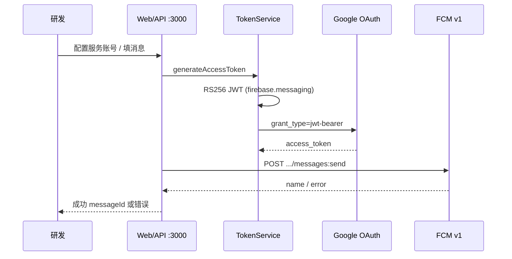

# 现状（As-Is）

**Status:** confirmed  
**Confirmed-at:** 2026-10-29（用户回复「确认」）  
**Prerequisite:** `02-acceptance-criteria.md`（confirmed）  
**Evidence:**
- `/Volumes/SSD-APFS/workplace/firebase-test/firebase-push-token`（`server.js`、`services/*`、`config/index.js`、`public/`、`demo.js`）
- `/Volumes/SSD-APFS/workplace/rn/cleanourmac`（`lib/features/shell/app_shell.dart`、`sidebar.dart`、`jwt/`、`settings_repository.dart`）

## 参与方

| 角色 | 现状行为 |
|------|----------|
| 移动研发 | 调试推送时另开 Node FCM 工具；设备/RN/清理在开发助手内完成 |
| 开发助手 | 无 FCM 类目；有 JWT 本地签发/校验（密钥不落盘） |
| firebase-push-token | 独立 Node 服务：OAuth + FCM v1 发送 + Web UI |

## 当前推送调试流（firebase-push-token）

### 能力事实

- **鉴权：** 服务账号 JSON → JWT（`iss/scope/aud/exp`，RS256）→ `https://oauth2.googleapis.com/token` → Bearer Access Token。
- **发送：** `POST https://fcm.googleapis.com/v1/projects/{projectId}/messages:send`。
- **消息：** 简化格式 `{token,notification,data?,android?}` 或完整 `{message:{...}}`；`data` 值转字符串。
- **批量：** `sendMulticastNotification` 逐 token 循环，汇总 success/failure（非 FCM 原生 multicast HTTP API）。
- **配置：** 默认读 `firebase-adminsdk.json`；亦支持环境变量；Web 可 `POST /api/config` 热更新运行时配置，`DELETE` 清除。
- **演示：** `demo.js` / `/api/demo-data` 提供示例 payload（含示例 device token）。
- **UI：** `public/index.html` 管理页；`npm run server` 起静态站 + API。

### 痛点

1. 与开发助手分离，需 `npm install` + 启 3000 端口。
2. 设备调测（ADB/模拟器）与推送调试不在同一工作台。
3. 服务账号文件落在仓库旁，易误提交（虽有安全提示）。
4. OAuth 每次发送前现生成 Token，无会话级复用缓存（功能可用，略冗余）。

## 开发助手现状（无 FCM）

- **壳：** 侧栏 9 项（工作台、JWT、设备、RN、扫描清理、项目缓存、AI 缓存、大文件、设置）；`IndexedStack` 缓存页。
- **相近模式：** JWT 页本地密码学/OpenSSL，文案明确密钥不写 settings/缓存。
- **设置：** `SharedPreferences` 存路径/语言等非密钥配置；无 Keychain 封装给任意密钥。
- **网络：** 现有功能以本机 shell 为主；FCM 将是明确的出站 HTTPS 能力。

## 系统与数据边界

| 系统 | 数据 | 边界 |
|------|------|------|
| 本机文件 `firebase-adminsdk.json` | 私钥、client_email、project_id | 测试工具默认源 |
| 运行时内存 config | 同上（热更新） | Node 进程内 |
| Google OAuth / FCM | JWT、Access Token、推送载荷 | 公网 Google API |
| 开发助手 | 无 FCM 凭据与发送状态 | 缺口 |

## 例外与缺口

- 完整 JSON 若不含 notification（仅 data 静默消息）时，现网 `validateMessageData` 仍要求 notification.title/body —— 与部分真实 FCM 用法不完全一致（As-Is 事实；To-Be 是否放宽待定）。
- Windows 上 Node 工具理论上可跑；开发助手 FCM 页 Windows 支持为后续 To-Be 声明。
- **未知（不阻塞 As-Is 确认）：** 团队日常是否多 Firebase 项目并行；示例 token 是否仍有效（不影响架构描述）。

## 请确认

请确认以上 As-Is 是否与你认知一致。确认后标记 `confirmed`，并进入 `04-to-be.md`（将先请你决定凭据提供/持久化策略）。
