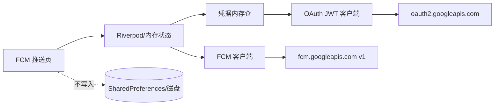

# 目标态（To-Be）

**Status:** confirmed  
**Confirmed-at:** 2026-10-29（用户回复「确认，可以使用 plan 模式完成」）  
**Prerequisite:** `03-as-is.md`（confirmed）；决策 D-01～D-04  
**映射：** 目标见 `01`；验收 AC-01～AC-10 见 `02`；痛点见 `03`

## 已确认决策

| ID | 决策 |
|----|------|
| D-01 | MVP = C（接近现有 Web 全量） |
| D-02 | 服务账号仅会话内存；粘贴 JSON 或选文件导入；不落盘 |
| D-03 | 侧栏名「FCM 推送」，位于 JWT 之后、设备调测之前 |
| D-04 | 本阶段保留 `firebase-push-token`；日常改用助手，不删 Node |

## 目标体验与行为

1. 用户打开侧栏 **FCM 推送**，页面分区大致为：配置 / 消息编辑 / 发送与结果 / 会话记录。
2. **配置：** 粘贴服务账号 JSON 或选择本地 `.json` 文件导入；可保存多套**仅内存**配置并命名切换；可删除某套或清空全部。离开应用或进程退出后配置消失（符合 D-02）。
3. **Token：** 可手动「生成 Access Token」查看状态；发送时若无有效 Token 或已过期则自动刷新（过期按 JWT/OAuth expires 语义，会话内可短缓存 Access Token于内存）。
4. **简化发送：** 表单字段 token、title、body、可选 image、data（键值）、android 片段；发送走 FCM HTTP v1。
5. **完整 JSON：** 切换到 JSON 模式编辑 `message` 对象或完整 request body；发送前预览；校验失败不发送。
6. **批量：** 多行/逗号分隔多个 token；同一消息逐条发送；汇总成功/失败（对齐现网循环语义，非强制原生 batch API）。
7. **演示数据：** 一键填入可编辑的示例（示例 device token 可明显标注为占位）。
8. **记录：** 会话内列表展示时间、项目 ID、模式、成功/失败、messageId 或错误摘要；不含私钥与完整 Access Token。
9. **确认：** 批量发送前需明确确认，避免误触群发。

## 概念架构与边界

- **所有权：** 功能归属开发助手 `features/fcm`（概念名）；凭据与发送状态仅 UI/内存层持有。
- **信任边界：** 仅向 Google OAuth 与 FCM 出站；用户消息内自填 URL 由 FCM/客户端自行拉取，助手不代理。
- **与 Node：** 行为对齐 `firebase-push-token` 的发送与校验语义；实现为助手内原生能力，不调用本地 3000 端口。

## 业务规则

- BR-1：无有效服务账号时，禁止 OAuth/发送，提示先导入配置。
- BR-2：简化模式必填设备 token、notification.title、notification.body（与现网校验对齐）；完整 JSON 模式以解析后的 message.token 与 notification 为准，缺则报错。
- BR-3：`data` 值一律按字符串提交。
- BR-4：Access Token 与私钥只存内存；日志脱敏（Token/私钥截断或不打印）。
- BR-5：批量单项失败不中断整批；结果可逐条查看。
- BR-6：静默 data-only 是否放宽 notification 校验——**本阶段不放宽**（与 As-Is 一致）；若完整 JSON 缺 notification 则失败并提示。

## 错误与例外

- 配置 JSON 缺字段 / 私钥非 PEM：导入阶段失败。
- OAuth 失败：展示 Google 返回信息摘要。
- FCM 失败（无效 token、权限、项目不匹配等）：展示 status + error.message/details。
- 网络不可达：明确网络错误，不伪装为配置错误。

## 迁移意图

- 研发日常调试切到助手「FCM 推送」。
- `firebase-push-token` 保留对照与 Postman 集合；README 可后续补一句「推荐使用开发助手」（非本 Spec 代码强制）。

## 可观测性

- 页面内展示最近请求摘要与错误；开发模式下控制台可打脱敏日志。
- 不引入远程遥测上报推送内容。

## 平台

- **必达：** macOS。
- **Windows：** 同页可用（文件选择与 HTTPS）；若系统证书/文件 API 差异导致问题，允许后续补丁，不阻塞 macOS 验收。

## 方案对比（已选）

| 方案 | 结论 |
|------|------|
| 纯 Dart 重实现 FCM 客户端 | **采用** — 符合本地助手、无 Node 依赖 |
| 助手内嵌/拉起 Node 服务 | 拒绝 — 运维与分发成本高 |
| 仅深链打开原 Web | 拒绝 — 达不到工作台整合 |

## 与验收映射

AC-01←侧栏 D-03；AC-02←多套内存配置；AC-03←OAuth；AC-04/05/06/07←发送能力；AC-08←会话记录+D-02；AC-09←出站边界；AC-10←macOS。

## 请确认

请确认本 To-Be（含 D-01～D-04 与行为规则）。确认后将标记整套 Spec 可进入实施计划 `plans/`。
